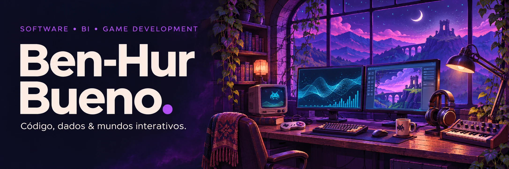

  

  <strong>Desenvolvimento de software · Business Intelligence · Games</strong>

  Na <a href="https://www.linkedin.com/company/aliare/"><strong>Aliare</strong></a>, desenvolvo o frontend de uma plataforma de <strong>Business Intelligence</strong> e contribuo no backend. 
  Também desenvolvo <strong>jogos</strong> e entrego <strong>sites e sistemas em WordPress</strong>.

 

<picture>
  <source media="(max-width: 600px)" srcset="./assets/profile-focus-mobile.svg" />
  
</picture>

  Meshy · Tripo · ElevenLabs no processo de criação de assets e áudio.

  Música e games também fazem parte da minha forma de criar.

<h3 align="center">Minhas Redes Sociais</h3>

  
  &nbsp;
  

